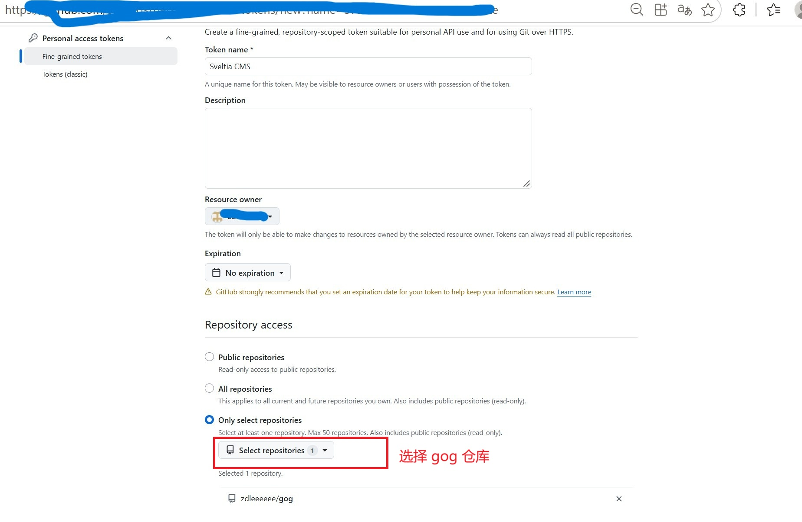
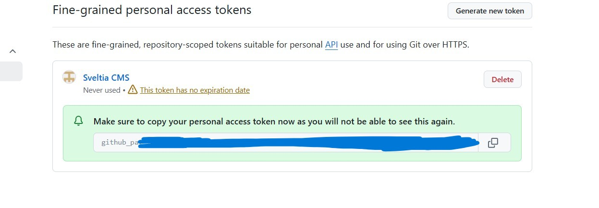

+++
title = "加入创作"
date = 2026-10-19T23:03:00.000+08:00
draft = false
summary = "本文说明加入创作的基本流程。"
ShowToc = true
ShowBreadCrumbs = true

[[author]]
name = "Zed Lee"
url = "/about/作者团队/#zed-lee"
+++

本文将说明加入创作的基本流程。

## 注册 GitHub 账号

使用邮箱注册 GitHub 账号即可，略。

## 加入成为仓库合作者

向Zed Lee发送你用于注册 GitHub 的邮箱，Zed Lee通过后请在 GitHub 通知里接受邀请。

## 添加token

进入 GitHub 的 **Settings → Developer settings → Personal access tokens → Fine-grained tokens**，点击“Generate new token”。

按以下配置填写：

- **Token name**：随便填，比如 `gog`
- **Expiration**：建议选 90 天，到期后重新生成一个替换即可（嫌麻烦也可以选择`No expiration`永不过期）
- **Repository access**：选 **Only select repositories**，然后选中 `gog`
- **Permissions**：点 **Add permissions**，找到 **Contents**，设为 **Read and write**

点击生成后，**立刻复制**那串以 `github_pat_` 开头的 token。页面关掉后就再也看不到了。

## 登录

访问[摆烂诸神](https://zdleeeeee.github.io/gog/)，点击右上角“登录”。画面会提示登录方式，选择Token登录，然后粘贴刚才的 token 登录即可。

修改文章内容后，网站重新部署会需要等待两三分钟的时间才能看到更新，请耐心等待。
