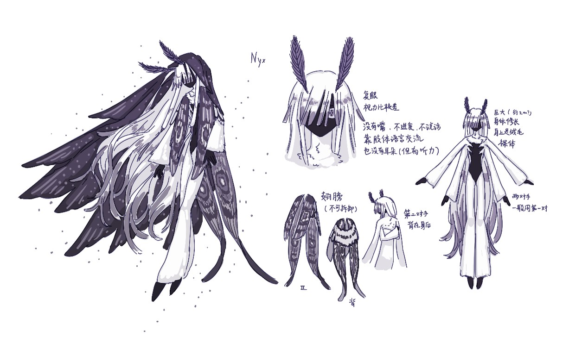
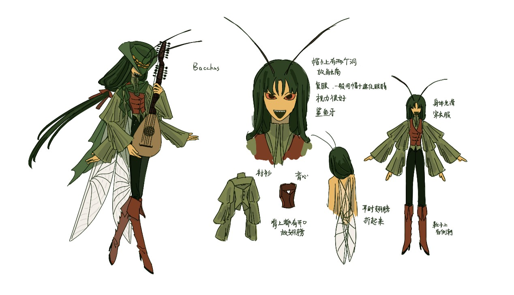

+++
title = "博拉迪亚"
date = 2026-10-18T10:34:26.000+08:00
draft = false
tags = [ "博拉迪亚" ]
ShowToc = true
ShowBreadCrumbs = true

[[author]]
name = "我能在患有健忘症的情况下"
url = "/about/作者团队/#zed-lee"

[cover]
image = "/lore/westnor/博拉迪亚/bacus.jpg"
hiddenInList = false
hiddenInSingle = true
+++

## TODO

完善内容

---

博拉迪亚帝国Balladea
👆具体设定一点也没想但是名字先憋出来设定啥的等我捏点神再完善好了
想缝的元素：文艺复兴、天灾、宗教、魔法蒸汽动力装甲（？）

大概是一些远古时期神战的古战场之一，所以die过很多神，各种神die了以后往这个国家上方的新鲜空气里库库叠加权柄，导致该国整个乱成一锅粥赶紧趁热喝了吧，有些留下的权柄偶尔还会搞点天灾什么的

现在有很多还活着的神在这里摆烂，具体有什么没想好但是应该是不止一个神（大概会直接大量抄袭希腊/博拉迪亚神话），基本上不管人类但是会偶尔开组会，比比谁收的贡品多，然后挑选幸运人类变成兽耳娘

每个神会有对应的神庙去祭祀，包括历史上die了的神。祭祀dead神可以直接从空气里弥散的权柄中获取力量，祭祀还活着的神越祭祀越容易被神看见，也越容易被赐福。国家里不同地区会有不同的信仰倾向（当然一个也没想）。基本上形成了完善的信仰体系所以一般不会出现莫名其妙变成兽耳娘的情况。

应该是一个多民族（种族）统一的帝国，但是不同的民族之间有高下之分（存在奴隶）

文明是起源于漠益那边，文化上和漠益有不少重合，但是和漠益关系烂maybe

政治制度是政教合一，祭祀活动和魔法事务都会归国家管，国家统帅是皇帝，行政制度是大概二元制吧

不太清楚科技应该在什么水平，应该是有在努力发展魔法工业的

国家的气候环境自然资源应该都还行，物质上比较富裕，人民整体的气质比较开放，爱喝酒唱歌开impart

## 神明

### 倪克斯 厄运之神

倪克斯（Nyx）被博拉迪亚人视为黑夜女神。本体是某种蚕蛾（或许在漫长的岁月中祂的原型生物已经灭绝），自我性别认知为女，作为昆虫类有两对手，但是一般只用第一对手，第二对手藏在翅膀下面，都当神了要那么多手干什么（

权能有关厄运，如果不能太超模的话就是把运气转化成力量或者是别的buff好了，给人加bad luck的debuff但是同时可以强化数值之类的。所以也被称厄运女神（但是为什么是黑夜女神大约是因为是神里面为数不多的夜行性生物）

是一个很中立的神，日常基本上什么也不会干，也不会和别人结仇，也不大管人类但是对人类友善，晚上趁大家睡着了出来散步，实际上到处都会去转转但是和博拉迪亚这边的神关系好就大部分时间混在这边（神际关系网当然还没捏）。如果有人类崇拜祂供奉祂祂就给点赐福，基本上有求都会给，不过因为会得到debuff所以信徒也不多。

大概在神代战争的时候die了，本来是不会参加这种战争，可能是运气太差莫名其妙被卷入战争里面成为倒霉蛋牺牲品or对面鲨疯了所以莫名其妙也被鲨了，现在躺在神墓里面还会有活着的神来看望祂

博拉迪亚曾经遭遇过的天灾很多都是因为Nyx的陨落，加上其他陨落的神所逸散的权柄所导致（大概就是祂的权柄强化了原本的灾害导致直接形成重量级天灾）想法是在神代战争里die了的这些神的权柄混在一起给博拉迪亚整了个类似圣经十灾那种非常大的大型连续剧，后面活着的神给博拉迪亚人民疯狂赐福让他们挺了过来

### 巴克斯 狂欢之神

巴克斯（Bacchus）被视为诗与酒之神。本体是某种螽斯，自我性别认知为无性/双性，两对手一对用来弹鲁特琴一对用来弹里拉琴（都当神了要那么多手干什么那当然是可以同时弹两把琴了），很吵，被祂赐福的人类说不定也能长出两对手但是感觉好猎奇啊还是别了。。。

大概在神战里die了，陨落的时候博拉迪亚上空打了三天的雷。祂一生对博拉迪亚的贡献很大，maybe帮博拉迪亚打跑了很多外敌，博拉迪亚的国名Balladea就是由祂而来。博拉迪亚人在春天会有一个持续三天的节日来纪念祂，到时候会有集会，大家一起不上班聚在大街上唱歌喝酒玩乐（消费过世神明是这样的）
权柄可能和声音，喧闹之类的概念有关，没想好但是基本上就是嗓门越大buff越强吧，，在博拉迪亚这个神的信徒比较多，所以在博拉迪亚随处可见剧院和舞台以及角斗场之类的这种娱乐场所，用来把喜欢吵吵闹闹的人集中在一起吵吵闹闹（？ 

性格喜怒无常，情绪起伏大，开心的时候赐福人类，愠怒的时候降下神罚，不过忘性大不记仇，基本上博拉迪亚人也这个性子，所以和博拉迪亚的人类一起玩的很好，属于双向奔赴了。爱好喧闹和聚会，喜欢看人类表演（抵制动物表演。。。），所以也是戏子和诗人的保护神。如果有人笑得很开心祂就会来看一眼是什么乐子，所以也算是欢愉之神（。感觉被祂赐福太多会得双相

手上拿的琴应该是人类进贡的，祂很喜欢这些乐器，die了以后祂拿过的琴被人类作为圣物拿回去放神殿了
